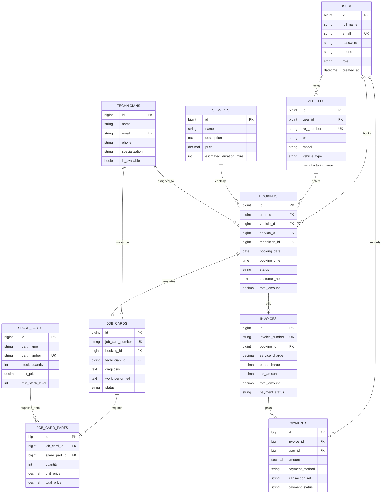

# Vehicle Service Booking & Tracking System
### Enterprise Web Application for Modern Workshop Automation
**Database Systems Engineering (DBMSE) & Distributed Backend Development Final Project**

[](https://spring.io/projects/spring-boot)
[](https://reactjs.org/)
[](https://www.mysql.com/)
[](https://www.oracle.com/java/)
[](https://jwt.io/)
[]()

---

## 1. Project Title & Abstract

### Title
**Vehicle Service Booking & Tracking System (VehicleCare)**

### Abstract
VehicleCare is a distributed, multi-tiered enterprise web application designed to digitize and streamline automotive service center operations. Traditional vehicle repair workshops rely heavily on fragmented paper logs, manual technician allocation, unmonitored spare parts depreciation, and opaque customer communication. This project delivers a high-performance web solution featuring:
- **Customer Self-Service Portal**: Customers register vehicles, book customized maintenance services, view live repair progress through a real-time stepper tracker, and download itemized billing receipts.
- **Enterprise Management Console**: Administrators oversee service workloads, match certified technicians by specialization, record diagnostics on digital Job Cards, track spare parts inventory with automated stock decrement, and generate GST-compliant invoices.
- **Technician Portal**: Field mechanics review service job assignments, record labor notes, and requisition spare parts.

Built strictly with an industrial-grade technology stack (**React 18 + Vite**, **Java Spring Boot 3.3.5**, **Hibernate 6 ORM**, and **MySQL 8.x**), this system enforces ACID transactional integrity, role-based access control (RBAC), and RESTful API conventions.

---

## 2. Problem Statement

Automotive service centers face significant operational hurdles:
1. **Inefficient Scheduling & Overbooking**: Without centralized slot tracking, workshops suffer from bottlenecked work bays or idle technician hours.
2. **Customer Opaque Experience**: Vehicle owners lack visibility into repair progress, causing customer frustration and repetitive status inquiries.
3. **Inventory Leakage & Stockout**: Spare parts (engine oil, brake pads, filters) are frequently utilized without immediate ledger deductions, causing inventory discrepancies and unexpected parts shortages.
4. **Disjointed Billing**: Manual calculations lead to pricing discrepancies between the initial estimate, labor hours, and actual replacement parts used.

VehicleCare directly solves these problems through transactional database constraints, an automated job card lifecycle, and instant notification-friendly status transitions.

---

## 3. Proposed System

VehicleCare introduces a cohesive, automated ecosystem:
- **Centralized Service Catalog**: Pre-configured service tiers (General Service, Brake Service, AC Diagnostics, Full Inspection) with standardized pricing and duration.
- **Real-Time Stage Progression**: Every vehicle moves through a strict 4-stage lifecycle: `BOOKED` → `CONFIRMED` → `IN_PROGRESS` → `COMPLETED` (or `CANCELLED`).
- **Atomic Spare Parts Allocation**: Mechanics allocate replacement components directly to a vehicle's Job Card; database transactions atomically deduct inventory stock and block allocation if stock is insufficient.
- **Automated Billing Engine**: Invoices dynamically aggregate the base service fee and exact line-item parts costs, preventing human calculation errors.
- **Role-Based Security**: Stateless JWT authentication ensures that customers only access their own vehicles/records, while admin consoles are protected by server-side Spring Security role enforcement.

---

## 4. System Architecture & Design Patterns

The system adheres to a decoupled **Client-Server 3-Tier Layered Architecture**:

```
+-------------------------------------------------------------------------+
|                        PRESENTATION TIER (FRONTEND)                     |
|  React 18 SPA | Vite | React Router v6 | Axios Interceptors | Context API|
+-------------------------------------------------------------------------+
                                    │  HTTPS / JSON
                                    ▼
+-------------------------------------------------------------------------+
|                         APPLICATION TIER (BACKEND)                      |
|  Spring Boot 3.3.5 REST API | Spring Security 6 | JJWT (HMAC-SHA256)    |
|                                                                         |
|  [Controllers] ──> [Service Layer] ──> [Spring Data JPA Repositories]   |
|         │                  │                               │            |
|     REST DTOs       ACID Transactions             Hibernate 6 ORM       |
+-------------------------------------------------------------------------+
                                    │  JDBC (MySQL Connector/J 8.0)
                                    ▼
+-------------------------------------------------------------------------+
|                          DATABASE TIER (STORAGE)                        |
|  MySQL 8.0 Relational Engine (InnoDB) | B-Tree Indexes | Foreign Keys   |
|  10 Tables: users, vehicles, services, technicians, spare_parts, etc.  |
+-------------------------------------------------------------------------+
```

### Applied Software Design Patterns
- **Layered Architecture (Separation of Concerns)**: Clear boundaries between Presentation (React), Controller, Service (Business Logic), Repository (Data Access), and Database (Storage).
- **Data Transfer Object (DTO) Pattern**: Request and Response payloads decouple internal database entities from external API contracts, preventing over-fetching and protecting internal hashes.
- **Repository Pattern**: Spring Data JPA abstracts low-level SQL queries into type-safe Java interfaces.
- **Dependency Injection & Inversion of Control (IoC)**: Spring Framework manages lifecycle and autowiring of services, repositories, and security filters.
- **Singleton Pattern**: Spring service beans and configuration providers run as thread-safe singletons.
- **Factory & Filter Chain Pattern**: Spring Security uses the Servlet Filter pattern (`JwtAuthenticationFilter`) to intercept, inspect, and authenticate bearer tokens before reaching API controllers.
- **Global Exception Handling**: Centralized `@RestControllerAdvice` translates unchecked domain exceptions into uniform HTTP JSON error schemas.

---

## 5. Database Schema & ER Diagram

The database runs on the **InnoDB** storage engine, ensuring **ACID compliance** and foreign key enforcement.



---

## 6. Technology Stack & Justification

| Layer | Component | Version | Justification |
| :--- | :--- | :---: | :--- |
| **Frontend** | React.js | 18.3.1 | Declarative component model, virtual DOM for fast rendering, large ecosystem. |
| **Frontend** | Vite | 6.x | Lightning-fast Hot Module Replacement (HMR) and optimized rollup production bundles. |
| **Frontend** | React Router | 6.28.0 | Declarative client-side routing with nested layout and protected route guards. |
| **Frontend** | Axios | 1.7.9 | Promise-based HTTP client with automatic request/response interceptors for JWT injection. |
| **Frontend** | Lucide React | 0.460.0 | High-performance, tree-shakeable SVG icons. |
| **Backend** | Java | 21 LTS | High performance, virtual threads, robust static typing, enterprise standard. |
| **Backend** | Spring Boot | 3.3.5 | Industry standard for Java microservices; rapid scaffolding, auto-configuration. |
| **Backend** | Spring Security | 6.x | Enterprise defense-in-depth security, filter-chain architecture, BCrypt password hashing. |
| **Backend** | JJWT | 0.12.6 | Secure, compact, URL-safe JSON Web Token implementation for stateless sessions. |
| **Backend** | Spring Data JPA / Hibernate | 6.5.x | Object-Relational Mapping (ORM) reducing boilerplate JDBC code while preventing SQL injection. |
| **Database** | MySQL | 8.0.x | Enterprise relational DBMS with ACID compliance, foreign key integrity, and B-Tree indexing. |
| **Docs** | Springdoc OpenAPI | 2.6.0 | Automated OpenAPI 3.0 specification generation with interactive Swagger UI. |

---

## 7. Project Folder Structure

```
d:\DBMSE\Vechile_Service_Management\
└── vehicle-service-booking-system/
    ├── backend/
    │   ├── .mvn/wrapper/                  # Maven wrapper binaries
    │   ├── src/
    │   │   ├── main/
    │   │   │   ├── java/com/vehicleservice/
    │   │   │   │   ├── VehicleServiceApplication.java
    │   │   │   │   ├── config/            # SecurityConfig, JwtTokenProvider, OpenApiConfig
    │   │   │   │   ├── controller/        # 11 REST Controllers (@RestController)
    │   │   │   │   ├── dto/               # 23 Request / Response DTO classes
    │   │   │   │   ├── entity/            # 15 JPA Entities (@Entity, @Table)
    │   │   │   │   ├── exception/         # GlobalExceptionHandler & Domain Exceptions
    │   │   │   │   ├── repository/        # 10 Spring Data JPA Repositories
    │   │   │   │   └── service/           # 11 Business Logic Services (@Service)
    │   │   │   └── resources/
    │   │   │       └── application.properties
    │   │   └── test/java/com/vehicleservice/
    │   │       ├── VehicleServiceApplicationTests.java
    │   │       └── service/
    │   │           ├── AuthServiceTest.java
    │   │           ├── BookingServiceTest.java
    │   │           └── InventoryAndBillingTest.java
    │   ├── .env.example
    │   ├── mvnw / mvnw.cmd
    │   ├── pom.xml
    │   └── README.md
    │
    ├── frontend/
    │   ├── public/
    │   ├── src/
    │   │   ├── components/                # Navbar, Footer, StatusBadge, TrackerProgress, Modal
    │   │   ├── context/                   # AuthContext with persistent login & roles
    │   │   ├── pages/                     # Home, Services, Vehicles, Booking, Tracking, History, Admin
    │   │   ├── services/                  # Axios API client methods
    │   │   ├── App.css                    # Professional responsive stylesheet
    │   │   ├── App.jsx                    # Route hierarchy
    │   │   └── main.jsx                   # Entry point
    │   ├── .env / .env.example
    │   ├── index.html
    │   ├── package.json
    │   ├── vite.config.js
    │   └── README.md
    │
    ├── database/
    │   ├── schema.sql                     # Full DDL table definitions & foreign keys
    │   ├── sample-data.sql                # Seed data (Users, Vehicles, Services, Techs, Parts)
    │   └── er-diagram.mmd                 # Mermaid ER diagram source
    │
    ├── docs/
    │   ├── SYSTEM_ARCHITECTURE.md         # Component diagrams & data flow explanations
    │   ├── DATABASE_DESIGN.md             # Normalization, data types, indexes, deletion rules
    │   ├── API_DOCUMENTATION.md           # Endpoints, payloads, query parameters, status codes
    │   └── TESTING.md                     # Unit & integration test execution guide
    │
    ├── services/
    │   └── predictive_maintenance.py      # Rule-based vehicle health & maintenance prediction script
    ├── .gitignore
    └── README.md                          # Master documentation (this file)
```

---

## 8. Prerequisites & Environment Setup

Ensure the following runtimes are installed on your machine:
1. **Java JDK 21+** (`java -version` returns Java 21, 23, or 25).
2. **Node.js 18+ & npm 9+** (`node -v` and `npm -v`).
3. **MySQL Server 8.0+** running on `localhost:3306`.
4. **Git** for source control.

---

## 9. Step-by-Step Installation & Run Guide (PowerShell)

### Step 1: Initialize Database in MySQL
Open PowerShell or MySQL Workbench and execute the database scripts:
```powershell
# Open MySQL CLI (enter your MySQL root password when prompted)
mysql -u root -p -e "CREATE DATABASE IF NOT EXISTS vehicle_service_db;"
mysql -u root -p vehicle_service_db < "d:\DBMSE\Vechile_Service_Management\vehicle-service-booking-system\database\schema.sql"
mysql -u root -p vehicle_service_db < "d:\DBMSE\Vechile_Service_Management\vehicle-service-booking-system\database\sample-data.sql"
```

### Step 2: Start Spring Boot Backend
Open a **new** PowerShell window:
```powershell
cd "d:\DBMSE\Vechile_Service_Management\vehicle-service-booking-system\backend"

# Run all 16 automated tests to verify stability
.\mvnw.cmd test

# Start the Spring Boot backend server
.\mvnw.cmd spring-boot:run
```
*The backend will boot up on port `8080`. Verify by browsing to [http://localhost:8080/swagger-ui.html](http://localhost:8080/swagger-ui.html).*

### Step 3: Start React Frontend
Open a **second** PowerShell window:
```powershell
cd "d:\DBMSE\Vechile_Service_Management\vehicle-service-booking-system\frontend"

# Install frontend dependencies (if not already installed)
cmd /c npm install

# Start the Vite development web server
cmd /c npm run dev
```
*The frontend will launch at [http://localhost:5173](http://localhost:5173).*

---

## 10. Default Accounts & Role Credentials

The database comes pre-seeded with accounts for all roles:

| Role | Email | Password | Permissions & Available Actions |
| :--- | :--- | :---: | :--- |
| **ADMIN** | `admin@vehicleservice.com` | `admin123` | **Full Workshop Authority**: View KPI analytics, assign technicians, manage job cards, add/deduct inventory, issue invoices, add services. |
| **CUSTOMER** | `jhansi@gmail.com` | `123456` | **Vehicle Owner**: Add/view registered vehicles, book appointments, view live repair tracker, access service history and invoices. |
| **CUSTOMER** | `arun@example.com` | `123456` | **Secondary Owner**: Pre-configured customer with distinct vehicles. |
| **TECHNICIAN** | `ravi.tech@vehicleservice.com` | `tech123` | **Workshop Specialist**: Access assigned work orders and diagnostic updates. |

> **Pro Tip**: The Login page features **One-Click Quick Fill Buttons** for instant role switching without typing credentials.

---

## 11. API Documentation Summary & Swagger UI

Interactive API documentation with runnable endpoints is live at:
**[http://localhost:8080/swagger-ui.html](http://localhost:8080/swagger-ui.html)**

### Key Endpoint Groups:
- **Authentication**: `POST /api/auth/register`, `POST /api/auth/login`, `GET /api/auth/me`
- **Vehicles**: `GET /api/vehicles/my-vehicles`, `POST /api/vehicles`, `PUT /api/vehicles/{id}`, `DELETE /api/vehicles/{id}`
- **Services Catalog**: `GET /api/services`, `POST /api/services`, `PUT /api/services/{id}`, `DELETE /api/services/{id}`
- **Bookings**: `POST /api/bookings`, `GET /api/bookings/my-bookings`, `GET /api/bookings/{id}`, `PUT /api/bookings/{id}/status`, `PUT /api/bookings/{id}/cancel`
- **Technicians**: `GET /api/technicians`, `POST /api/technicians`, `PUT /api/technicians/{id}/assign`
- **Job Cards**: `GET /api/job-cards`, `POST /api/job-cards`, `POST /api/job-cards/{id}/parts`, `PUT /api/job-cards/{id}/status`
- **Inventory**: `GET /api/spare-parts`, `POST /api/spare-parts`, `PUT /api/spare-parts/{id}/stock`
- **Invoices & Payments**: `GET /api/invoices`, `POST /api/invoices`, `POST /api/payments`
- **Admin Analytics**: `GET /api/dashboard/stats`

---

## 12. Frontend Navigation & User Experience

```
[VehicleCare Navbar]
   │
   ├── [Home] ─────────── Hero section, quick booking CTA, service highlights, process flow
   ├── [Services] ─────── Interactive cards with prices in ₹, durations, instant "Book" buttons
   ├── [My Vehicles] ──── Garage view: Add new car/bike, inspect registration numbers, delete
   ├── [Book Service] ─── Multi-step booking form (auto-populates vehicles & services)
   ├── [Live Tracking] ── Interactive 4-step progress stepper with status details & refresh
   ├── [History] ──────── Past service records & printable invoice receipts
   └── [Admin Console] ── (Admin only) 8 management sub-tabs:
                           • Overview KPI Cards & Recent Work Orders
                           • Bookings & Tech Allocation
                           • Job Cards & Diagnosis
                           • Spare Parts Inventory Management
                           • Invoices & Financial Settlement
                           • Catalog Management
                           • Technicians Directory
                           • Customer Registry
```

---

## 13. Security Implementation (JWT, BCrypt, RBAC)

1. **Password Encryption**: Stored passwords use Spring Security's `BCryptPasswordEncoder` with standard 10 salt rounds. Plaintext passwords are never persisted.
2. **Stateless JWT Authorization**:
   - On successful `/api/auth/login`, a signed **HMAC-SHA256 JWT** containing the subject (email), user ID, and granted authority (`ROLE_CUSTOMER`, `ROLE_ADMIN`, or `ROLE_TECHNICIAN`) is returned.
   - Frontend stores the token securely and attaches it via Axios interceptor: `Authorization: Bearer <token>`.
   - `JwtAuthenticationFilter` validates token signature, expiration, and extracts authorities before reaching the controller.
3. **Defense-in-Depth Method & Route Security**:
   - Backend routes are guarded with `@PreAuthorize("hasRole('ADMIN')")` or Spring Security's `.requestMatchers(...)`.
   - Hiding buttons on the React frontend is treated as purely cosmetic; the backend actively rejects unauthorized requests with `401 Unauthorized` or `403 Forbidden`.
4. **Ownership Verification**:
   - Customers can only book appointments for vehicles they legally own. Attempting to book a service using another customer's vehicle ID is intercepted by `BookingService` and rejected with `BadRequestException`.

---

## 14. Database Constraints & ACID Transactions

The database enforces data integrity through relational constraints and transactional boundaries:

1. **Foreign Key Constraints with Selective Cascade**:
   - Deleting a `User` cascades down to their `Vehicles`.
   - Deleting a `Vehicle` with existing `Bookings` is blocked by MySQL foreign key restrictions (`RESTRICT`) to safeguard audit trails.
2. **Unique Constraints**:
   - `users.email` (prevents multiple accounts per email).
   - `vehicles.reg_number` (guarantees vehicle uniqueness across the workshop).
   - `technicians.email` and `spare_parts.part_number`.
   - `job_cards.job_card_number` and `invoices.invoice_number`.
3. **Atomic Inventory Updates**:
   - In `JobCardService.addPartToJobCard()`, the method is decorated with `@Transactional`.
   - Stock deduction (`sparePart.setStockQuantity(current - requested)`) and line-item creation occur inside the same atomic transaction.
   - If requested quantity exceeds stock, an `InsufficientStockException` is thrown, causing an automatic **Rollback** so partial allocations are impossible.
4. **Defensive Price Snapshots**:
   - The booking form in the frontend does not send monetary prices to the backend. The backend resolves the official price directly from the `services` table to prevent client-side price tampering.

---

## 15. Sample Test Cases & Execution Results

Automated unit and integration test coverage is implemented in `backend/src/test/java/com/vehicleservice`:

```
-------------------------------------------------------
 T E S T S   E X E C U T I O N   R E S U L T S
-------------------------------------------------------
[INFO] Running com.vehicleservice.VehicleServiceApplicationTests
[INFO] Tests run: 1, Failures: 0, Errors: 0, Skipped: 0
[INFO] Running com.vehicleservice.service.AuthServiceTest
[INFO] Tests run: 3, Failures: 0, Errors: 0, Skipped: 0
[INFO] Running com.vehicleservice.service.BookingServiceTest
[INFO] Tests run: 8, Failures: 0, Errors: 0, Skipped: 0
[INFO] Running com.vehicleservice.service.InventoryAndBillingTest
[INFO] Tests run: 4, Failures: 0, Errors: 0, Skipped: 0
[INFO]
[INFO] Results: Tests run: 16, Failures: 0, Errors: 0, Skipped: 0
[INFO] ------------------------------------------------------------------------
[INFO] BUILD SUCCESS (100% Pass Rate)
[INFO] ------------------------------------------------------------------------
```

---

## 16. Common Errors & Troubleshooting Guide

| Issue | Root Cause | Resolution |
| :--- | :--- | :--- |
| **MySQL `Access denied for user 'root'@'localhost'`** | Incorrect password in `application.properties` | Open `backend/src/main/resources/application.properties` and update `spring.datasource.password=your_password`. |
| **Port 8080 or 3306 Already in Use** | Another instance is already bound to port 8080 | Find process using `Get-Process -Id (Get-NetTCPConnection -LocalPort 8080).OwningProcess` and stop it, or launch with `--server.port=8081`. |
| **`Table 'vehicle_service_db.users' doesn't exist`** | Schema was not executed | Run `mysql -u root -p vehicle_service_db < database/schema.sql`. |
| **`CORS Error` on frontend API calls** | Frontend URL not allowed or proxy missing | Check `vite.config.js` proxy settings or `SecurityConfig.java` CORS configuration. |
| **`npm : File ... npm.ps1 cannot be loaded`** | Windows PowerShell execution policy restriction | Run npm commands with `cmd /c npm <command>` (e.g. `cmd /c npm run dev`). |

---

## 17. Performance Optimization & Scalability

1. **Stateless Scalability**: Using signed JWT tokens eliminates the need for sticky HTTP sessions, allowing the backend to scale horizontally behind a load balancer (such as NGINX or AWS ALB).
2. **Indexed Search Columns**: Database indexes exist on `bookings.status`, `bookings.booking_date`, `vehicles.reg_number`, and `users.email` to ensure fast B-Tree lookups on high-traffic queries.
3. **Vite Code Splitting & Minification**: Production frontend builds bundle assets into compressed, chunked files with long-term caching hashes.
4. **Selective ORM Fetch Types**: JPA relationships use `FetchType.LAZY` where appropriate to prevent N+1 query performance degradation.

---

## 18. University Viva / Interview Questions & Answers

### Q1: Why did you choose Spring Boot instead of Express.js or raw Servlets?
> **Answer**: Spring Boot provides enterprise-grade structure with dependency injection, declarative transactions (`@Transactional`), standard ORM integration through Spring Data JPA, and security frameworks (`Spring Security 6`). In a Database Systems project, ensuring thread safety and strict transactional boundaries is critical, which Spring handles out-of-the-box.

### Q2: How does the system handle concurrent spare parts allocation?
> **Answer**: In `JobCardService.addPartToJobCard()`, operations are wrapped in an atomic `@Transactional` boundary. When two concurrent requests attempt to reserve the same spare part, the InnoDB engine enforces row-level locks on the `spare_parts` row. Furthermore, our business logic checks `if (part.getStockQuantity() < request.getQuantity())` and throws an `InsufficientStockException`, causing an automatic transaction rollback.

### Q3: What is the purpose of JWT and why is it preferred over HTTP Session cookies?
> **Answer**: JWT enables stateless authentication. The server does not store active session records in memory or database; instead, the client sends a cryptographically signed token in the `Authorization: Bearer` header. The server verifies the HMAC-SHA256 signature using the secret key. This reduces database overhead and allows seamless horizontal scaling across distributed backend nodes.

### Q4: Explain the Normalization level of your database schema.
> **Answer**: The database schema is normalized up to **3rd Normal Form (3NF)**:
> - **1NF**: All columns contain atomic values, and each record has a primary key.
> - **2NF**: All non-key attributes are fully functionally dependent on the entire primary key (no partial dependencies).
> - **3NF**: There are no transitive dependencies; non-key attributes depend only on the primary key (e.g., vehicle details reside in `vehicles`, customer info in `users`, and are linked to `bookings` via foreign keys).

---

## 19. Future Enhancements

1. **SMS & WhatsApp Notifications**: Integrate Twilio or WhatsApp Business API to send automated service stage alerts to vehicle owners.
2. **Automated Payment Gateway**: Add Razorpay / Stripe webhook integrations for online card and UPI payments.
3. **Real-Time Push Notifications**: Upgrade the polling mechanism to WebSockets or Server-Sent Events (SSE) for zero-latency dashboard alerts.
4. **Machine Learning Predictive Maintenance**: Connect the provided `services/predictive_maintenance.py` engine directly into the backend to suggest maintenance tasks based on odometer history.

---

## 20. Contributors & License

- **Developer**: 2nd-Year Computer Science Student
- **Course**: Database Systems Engineering & Distributed Backend Development
- **License**: MIT License - open for educational and non-commercial academic use.

---

## 21. Appendix (Useful SQL Queries & API Test Commands)

### Check Active Bookings & Assigned Technicians
```sql
SELECT b.id AS booking_id, u.full_name AS customer, v.reg_number, s.name AS service,
       t.name AS technician, b.status, b.booking_date
FROM bookings b
JOIN users u ON b.user_id = u.id
JOIN vehicles v ON b.vehicle_id = v.id
JOIN services s ON b.service_id = s.id
LEFT JOIN technicians t ON b.technician_id = t.id
ORDER BY b.booking_date DESC;
```

### Inspect Spare Parts Inventory with Low Stock Alert
```sql
SELECT part_name, part_number, stock_quantity, min_stock_level, unit_price,
       CASE WHEN stock_quantity <= min_stock_level THEN 'REORDER REQUIRED' ELSE 'IN STOCK' END AS inventory_status
FROM spare_parts;
```

### Test Authentication via PowerShell `curl`
```powershell
$body = @{ email = "admin@vehicleservice.com"; password = "admin123" } | ConvertTo-Json
$response = Invoke-RestMethod -Uri "http://localhost:8080/api/auth/login" -Method Post -Body $body -ContentType "application/json"
$token = $response.data.token
Write-Host "JWT Token received: $token"
```

---

## 22. Complete Demo Walkthrough Script

Follow these steps during your project demonstration:

1. **Open Frontend**: Navigate to `http://localhost:5173`.
2. **Log in as Customer**:
   - Click **Login**.
   - Click the **"Customer" Demo Fill** button (`jhansi@gmail.com` / `123456`) and click **Sign In**.
3. **Register a New Vehicle**:
   - Go to **My Vehicles** in the navbar.
   - Click **+ Register Vehicle**.
   - Enter `AP09CZ5555`, Brand: `Hyundai`, Model: `Creta`, Type: `SUV`, Year: `2023`.
   - Click **Save Vehicle** and see it appear in the garage list.
4. **Book a Service**:
   - Go to **Book Service**.
   - Select the newly registered vehicle (`AP09CZ5555`).
   - Select **General Service & Inspection** (₹1,499.00).
   - Pick tomorrow's date and a preferred time slot (e.g., `10:30 AM`).
   - Enter notes: *"Vibration at high speeds, brake squeal"*.
   - Click **Confirm Booking**. An alert displays your new Booking ID (e.g., `#2`).
5. **Inspect Live Tracking**:
   - Go to **Live Tracking**.
   - The interactive stepper shows `BOOKED` in blue.
6. **Switch to Admin Role**:
   - Click **Logout**.
   - Log in using the **"Admin" Demo Fill** button (`admin@vehicleservice.com` / `admin123`).
7. **Process the Booking (Admin Console)**:
   - Go to **Admin Console** -> **Bookings & Allocation** tab.
   - Locate Booking `#2`.
   - Click **Assign Tech** -> Select **Ravi Kumar** (Specialist: Engine & Transmission).
   - Status updates automatically to `CONFIRMED`.
8. **Create Job Card & Allocate Parts**:
   - Click the **Job Cards** tab -> Click **+ Create Job Card**.
   - Select Booking `#2`, assigned to Ravi Kumar. Diagnosis: *"Front brake pads worn out, low engine oil level"*.
   - In the Job Card details, click **+ Add Spare Part**.
   - Select **Brake Pad Set (Front)**, Quantity: `1`.
   - Observe the stock in the **Spare Parts Inventory** tab decrease automatically!
   - Update Job Card status to `IN_PROGRESS` and then `COMPLETED`.
9. **Generate & Print Invoice**:
   - Click the **Invoices & Billing** tab.
   - Click **Generate Invoice** for Booking `#2`.
   - Notice the system automatically sums the ₹1,499 service fee + spare parts costs.
   - Click **View / Print** to open the professional printable invoice modal.
   - Click **Record Payment** (Method: `UPI`, Ref: `UPI-99238411`). Status changes to `PAID`.
10. **Verify Customer Tracking**:
    - Switch back to Customer Jhansi.
    - Go to **Live Tracking** -> See the progress tracker reach `COMPLETED` with green checkmarks!

